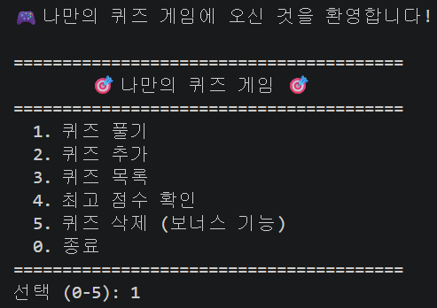

# 🎯 나만의 콘솔 퀴즈 게임 (Python Quiz Game)

Python 기본 문법과 객체 지향 프로그래밍(OOP)을 적용하고, JSON 파일 영속성과 Git 버전 관리 흐름을 실습하기 위해 제작된 콘솔 기반 퀴즈 게임 프로그램입니다.

---

## 📌 1. 프로젝트 개요
- **개발 언어**: Python 3.10+
- **사용 라이브러리**: Python 표준 라이브러리 (`json`, `sys`, `os`)
- **버전 관리**: Git, GitHub

---

## 💡 2. 퀴즈 주제 및 선정 이유
- **퀴즈 주제**: 파이썬 상식, 일반 상식, 게임 상식 종합 퀴즈
- **선정 이유**: 
  - 프로그래밍 입문자가 알아두면 좋은 **파이썬 기본 지식**과 일상에서 재미있게 풀 수 있는 **일반 상식**, 그리고 대중적으로 친숙한 **게임 상식**을 결합하여 누구나 흥미를 느끼고 쉽게 즐길 수 있는 퀴즈 게임을 만들기 위해 선정했습니다.

---

## 🚀 3. 실행 방법

### 사전 요구사항
- Python 3.10 이상 설치 권장

### 실행 명령어
```bash
# 1. 저장소 클론 및 이동
git clone https://github.com/dhfpswlrkddl/aio1-2.git
cd aio1-2

# 2. 프로그램 실행
python main.py
```

# 실행 예시


---

## ✨ 4. 주요 기능 목록

1. **퀴즈 풀기**
   - 저장된 문제를 순차적으로 출제하고 선택지(1~4번)를 입력받아 정답 여부를 즉시 피드백합니다.
   - 모든 문제를 푼 후 총점(100점 만점)을 계산하고, 최고 점수 갱신 여부를 판별하여 기록합니다.
2. **퀴즈 추가**
   - 새로운 문제, 보기 4개, 정답 번호를 입력받아 퀴즈 목록에 등록하고 즉시 파일에 저장합니다.
3. **퀴즈 목록 보기**
   - 현재 등록된 모든 퀴즈의 질문과 보기, 정답 정보를 한눈에 확인합니다.
4. **최고 점수 확인**
   - 프로그램 종료 후에도 유지되는 역대 최고 점수를 확인합니다.
5. **퀴즈 삭제 (보너스 기능)**
   - 등록된 퀴즈 중 특정 번호의 문제를 삭제하고 변경된 데이터를 파일에 저장합니다.
6. **견고한 예외 처리**
   - 입력값 공백 자동 제거 (`strip()`)
   - 빈 입력(Enter), 문자 입력(숫자 변환 실패), 범위 밖 번호 입력 시 친절한 안내 후 재입력 유도
   - 실행 중 `Ctrl + C` (KeyboardInterrupt) 또는 입력 스트림 종료(`EOFError`) 발생 시 데이터 유실 없이 안전하게 저장 후 종료
   - `state.json` 파일 부재 시 자동 생성, 파일 손상 시 기본값으로 안전 복구

---

## 📂 5. 파일 구조

```text
aio1-2/
│
├── main.py              # 메인 프로그램 (Quiz, QuizGame 클래스 정의 및 실행)
├── state.json           # 퀴즈 및 최고 점수 저장 데이터 (UTF-8)
├── README.md            # 프로젝트 안내 및 문서
└── .gitignore           # Git 제외 파일 목록
```

---

## 💾 6. 데이터 파일 설명 (`state.json`)

- **경로**: 프로젝트 루트 디렉터리 (`./state.json`)
- **인코딩**: UTF-8
- **역할**: 프로그램을 재시작해도 등록한 퀴즈와 최고 점수가 유지되도록 보장 (데이터 영속성)
- **JSON 스키마 구조**:
```json
{
    "quizzes": [
        {
            "question": "문제 내용 문자열",
            "choices": [
                "1번 보기",
                "2번 보기",
                "3번 보기",
                "4번 보기"
            ],
            "answer": 1
        }
    ],
    "best_score": 0
}
```

---

## 📸 7. 실행 화면 스크린샷 (제출 체크리스트)

> ※ 제출 시 캡처 이미지를 `docs/screenshots/` 경로에 저장 후 연결할 수 있습니다.

- [ ] 개발 환경 설정 스크린샷 (VS Code, Python 버전, Git 설정)
- [ ] 메인 메뉴 화면
- [ ] 퀴즈 풀기 진행 및 점수 갱신 화면
- [ ] 퀴즈 추가 화면
- [ ] 퀴즈 목록 화면
- [ ] `git log --oneline --graph` 터미널 화면
